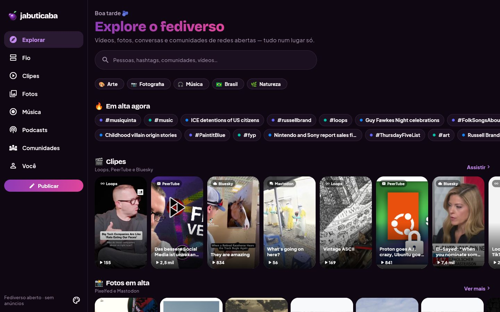
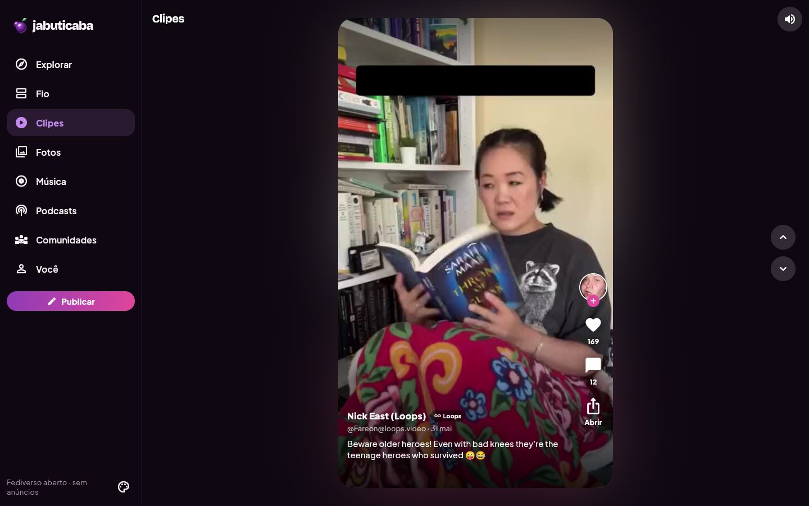
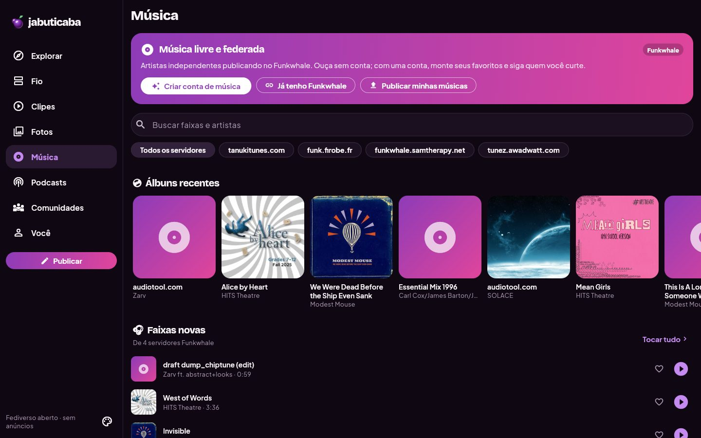
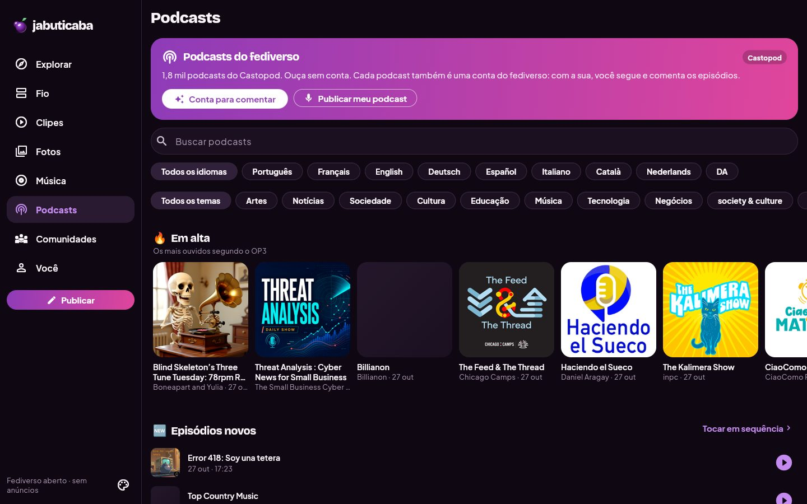
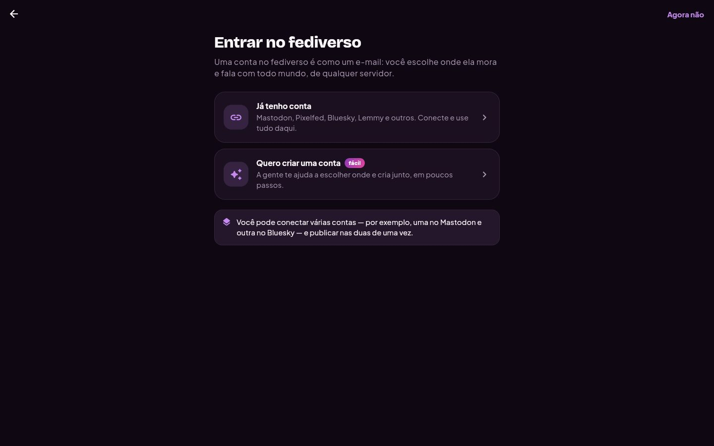
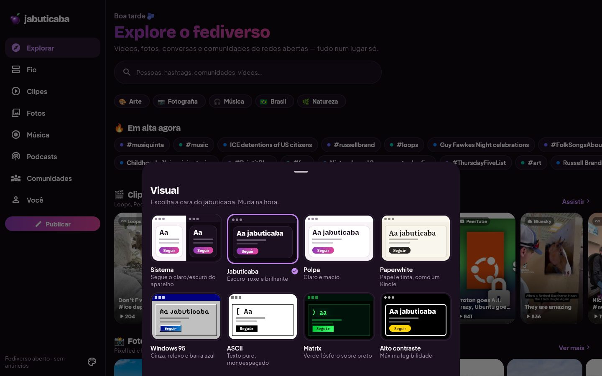
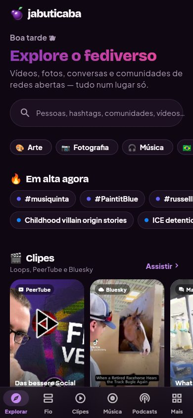
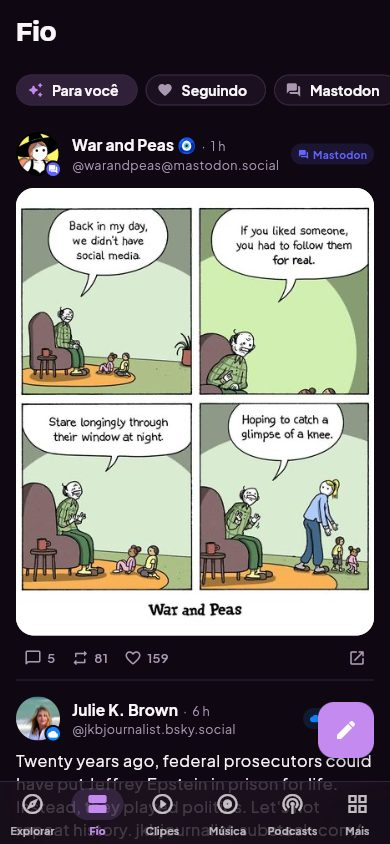
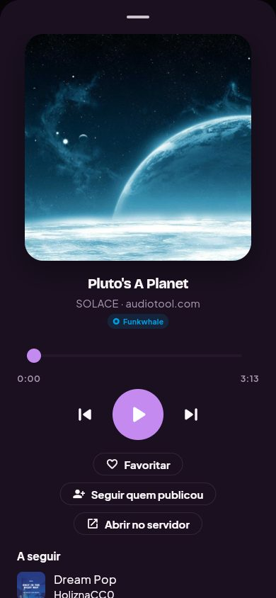
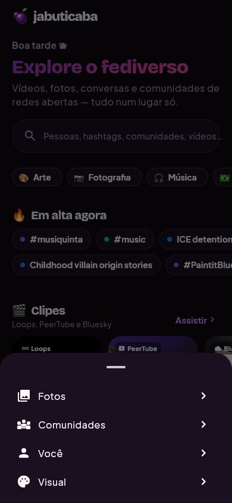

# 🫐 jabuticaba

Um explorador do fediverso: **vídeos curtos, fotos, conversas e comunidades** de redes abertas num app só — iOS, Android, macOS, Linux e Windows, com o mesmo código Flutter.

Uma obra da [Ways of Seeing](https://ways-of-seeing.github.io). **Apresentação:** <https://ways-of-seeing.github.io/jabuticaba/> · **Brandbook:** <https://ways-of-seeing.github.io/jabuticaba/brandbook.html>

A proposta não é só “colar o endereço da sua instância”: é **explorar primeiro**. Dá para descobrir, seguir e montar seu fio sem criar conta; quando quiser postar, o app ajuda a escolher um servidor.

## Telas

| Explorar | Clipes |
|---|---|
|  |  |
| **Música** | **Podcasts** |
|  |  |
| **Entrar no fediverso** | **Temas** |
|  |  |

| Explorar | Fio | Player | Mais |
|---|---|---|---|
|  |  |  |  |

**Todas as telas, menus e fluxos** (abas, post, perfil, comunidades, álbum, podcast, player, aviso de conta, cada passo de entrar no fediverso, primeiro uso e os oito temas): [docs/TELAS.md](docs/TELAS.md).

## Redes suportadas (leitura sem login)

| Rede | Formato no app | Fonte |
|---|---|---|
| **Mastodon** | Fio, hashtags, perfis, respostas | `/api/v1/trends/*`, timelines de hashtag, contas |
| **Bluesky** | Fio, feeds temáticos, tópicos em alta, vídeos | AppView pública `public.api.bsky.app` |
| **Pixelfed** | Fotos | `/api/pixelfed/v2/discover/posts/trending` |
| **Loops** | Clipes (vertical, estilo TikTok/Reels) | `/api/web/feed`, `/api/v1/explore/tags`, feeds de hashtag |
| **PeerTube** | Vídeos, canais | Sepia Search (busca global) + API de cada instância |
| **Lemmy** | Comunidades, discussões com comentários | `/api/v3/post/list`, `community/list`, `comment/list` |
| **Funkwhale** | Música: álbuns, faixas, player | `/api/v1/tracks` e `/albums` de pods abertos (tanukitunes, funk.firobe.fr, samtherapy, tunez) |
| **Castopod** | Podcasts: ~1.800 programas, episódios via RSS | [Castopod Index](https://index.castopod.org) + feed RSS de cada podcast |
| Diretório | Servidores para começar | `api.joinmastodon.org` |

## Sem Meta

O jabuticaba **não integra o Threads, o Instagram, o Facebook nem qualquer outro serviço da Meta**. O Threads conversa com o fediverso, então posts e contas do `threads.net` às vezes chegam pelas tendências e hashtags do Mastodon: o app **descarta esse conteúdo** antes de mostrar (`MastodonApi.fromMeta`, coberto por teste). Nada da Meta aparece no Explorar, no Fio, na busca, nas respostas ou no que você segue.

## Contas (opcional)

O fluxo **Entrar no fediverso** (no onboarding, na aba Você ou no botão Publicar) cobre dois caminhos:

- **Já tenho conta:** Mastodon e compatíveis (Pixelfed, GoToSocial, Akkoma…) por OAuth — a senha é digitada no site do servidor, nunca no app. No desktop o retorno é automático (servidor local em `127.0.0.1`); no celular a pessoa cola o código. **Bluesky** com senha de app (com suporte ao código 2FA por e-mail). **Lemmy** com usuário e senha (e código 2FA).
- **Quero criar:** a pessoa diz o que quer fazer (conversar, fotos, comunidades, vídeos). Para o Mastodon, o app recomenda um servidor (português e cadastro imediato primeiro, depois interesses e atividade), mostra regras e política, e **cria a conta pela API oficial** do servidor, inclusive idade mínima e justificativa quando o servidor exige. Pixelfed, Lemmy, Bluesky e Loops pedem captcha/telefone, então o app abre o cadastro no site e volta para conectar.

Com conta: aba **Minhas contas** no Fio (linhas do tempo juntas), curtir/compartilhar de verdade, "Seguir" também segue no servidor, e **Publicar** em várias contas ao mesmo tempo (respeitando o limite da rede mais restritiva, ex.: 300 no Bluesky). Tokens ficam no cofre do sistema (`flutter_secure_storage`: Keychain/Keystore/libsecret/DPAPI).

O Loops ainda não oferece login para apps de terceiros — os vídeos continuam aparecendo e podendo ser seguidos.

## Temas

Sistema, **Jabuticaba** (escuro), **Polpa** (claro), **Paperwhite** (papel e serifa Literata, fotos em tons de cinza, como um Kindle), **Windows 95** (cinza, relevo 3D, barra de título azul, fonte pixelada), **ASCII** (monoespaçado, `[ títulos ]`, imagens em tinta), **Matrix** (verde fósforo, chuva de caracteres) e **Alto contraste**. Cada tema é um `JabuStyle` em `lib/ui/theme.dart` que define cores, fontes, cantos, bordas, filtro de imagem e até a forma dos títulos — criar um tema novo é adicionar um valor ali.

## Marca

A pasta [`brand/`](brand/) tem a identidade do jabuticaba: [IDENTIDADE.md](brand/IDENTIDADE.md) (missão, visão, valores, personalidade e voz), o [brandbook visual](brand/brandbook.html) (logo, cores, tipografia, temas, interface) e o [media kit](brand/media-kit/README.md) (logos, ícones, imagens para redes, paleta, tokens e fontes com licença). Para regerar o kit e o brandbook:

```bash
python3 tool/brand/make_media_kit.py
```

## Ícone

`tool/icon/make_icon.py` desenha o ícone em SVG e exporta com o Inkscape (`assets/brand/`). Para regerar e aplicar em todas as plataformas:

```bash
python3 tool/icon/make_icon.py && dart run flutter_launcher_icons
```

## Abas

- **Explorar** — saudação, busca única, interesses, tópicos em alta, carrosséis de clipes, fotos, conversas, comunidades, vídeos, servidores, feeds e notícias.
- **Fio** — linha do tempo em texto misturando redes, com filtros (Minhas contas, Para você, Seguindo, Mastodon, Bluesky, Lemmy).
- **Clipes** — vídeos em tela cheia, deslizando na vertical (Loops, PeerTube, Bluesky, Mastodon). No desktop: setas ↑/↓, `J`/`K`, `M` para mudo.
- **Fotos** — grade masonry (Pixelfed + Mastodon + Bluesky), com filtros por hashtag.
- **Música** — Funkwhale: álbuns recentes, faixas novas, busca e filtro por servidor; favoritos com conta Funkwhale.
- **Podcasts** — Castopod: em alta, episódios novos, filtros por idioma e tema, busca; cada podcast é uma conta do fediverso que dá para seguir e comentar.
- **Comunidades** — comunidades Lemmy, servidores Mastodon por categoria, feeds do Bluesky e canais PeerTube.
- **Você** — o que você segue (salvo no aparelho), interesses, tema claro/escuro, mídia sensível.

## Áudio

Um player global (`lib/state/player.dart`) toca música e podcasts com o mesmo motor nativo dos vídeos; o mini player fica acima das abas e o player completo tem fila, velocidade (podcasts) e ações. Um clipe com som pausa o áudio.

- No celular a barra mostra Explorar, Fio, Clipes, Música e Podcasts; Fotos, Comunidades e Você ficam em **Mais**.
- O Castopod Index e os feeds RSS não liberam CORS: na versão **web**, aponte para um espelho com `--dart-define=CASTOPOD_INDEX=https://seu-espelho/podcastindex.json` e para um proxy de feeds com `--dart-define=FEED_PROXY=https://seu-proxy/?url=` (para testes locais há `tool/screens/feed_proxy.py`). No app nativo não há essa limitação.
- `dart run tool/smoke_audio.dart` confere as fontes de áudio contra os servidores reais.

## Rodando

```bash
flutter pub get
flutter run -d macos
```

> **Disco exFAT (VAULT):** volumes exFAT criam arquivos `._*` que quebram a assinatura de código do macOS. Por isso `build/` é um link para `~/Library/Caches/jabuticaba/build`. Se o link sumir (por exemplo após `flutter clean`), recrie:
>
> ```bash
> rm -rf build && mkdir -p ~/Library/Caches/jabuticaba/build && ln -s ~/Library/Caches/jabuticaba/build build
> ```
>
> Se o build reclamar de assinatura, rode `dot_clean -m .` na raiz do projeto.

Outras plataformas: `flutter run -d ios`, `flutter run -d android`, `flutter run -d linux`, `flutter run -d windows`, `flutter run -d chrome`.

### Modo demonstração

Para capturas de tela e apresentações, o build web aceita um modo que pula o onboarding e escolhe tema e aba pela URL:

```bash
flutter build web --release --dart-define=DEMO=true
# depois abra, por exemplo: /?aba=musica&tema=polpa  (ou &onboarding=1)
```

Abas: `explorar`, `fio`, `clipes`, `fotos`, `musica`, `podcasts`, `comunidades`, `voce`. Temas: `jabuticaba`, `polpa`, `paperwhite`, `win95`, `ascii`, `matrix`, `contraste`.

Também dá para abrir uma tela específica: `tela=` (`post`, `perfil`, `hashtag`, `comunidade`, `servidor`, `feed`, `busca`, `album`, `podcast`, `player`, `miniplayer`, `foto`, `clipe`, `aviso`, `aviso-musica`, `visual`, `guia`, `mais`), um passo de entrar no fediverso com `fediverso=` (`choose`, `connect`, `create`, `servers`, `signup`, `mastodonConnect`, `blueskyConnect`, `lemmyConnect`, `music`, `musicConnect`, `podcaster`), um segmento de Comunidades com `segmento=` (`groups`, `servers`, `feeds`, `channels`) e um passo do primeiro uso com `onboarding=1&passo=0..3`.

As capturas de [docs/TELAS.md](docs/TELAS.md) saem de `tool/screens/scenes.tsv` com `python3 tool/screens/capture.py` (instruções no cabeçalho do script).

## Estrutura

```
lib/
  models/models.dart      tipos unificados (Post, Author, Media, Community, Trend)
  services/               um cliente por rede (mastodon, bluesky, peertube, lemmy, loops, directory),
                          auth/ (OAuth, cadastro, sessões) e account_api (ações com conta)
  state/                  loaders (paginação e mistura de redes), interesses, preferências (Riverpod)
  ui/theme.dart           design system: 8 temas (JabuStyle), relevo Win95, filtros de imagem
  ui/shell.dart           barra lateral (desktop) / barra inferior (celular), um Navigator por aba
  ui/screens/             Explorar, Fio, Clipes, Fotos, Comunidades, Você, perfil, post, hashtag, busca
  ui/widgets/             cartões, mídia, vídeo, texto rico, listas paginadas
```

Todo conteúdo vira um `Post` comum; cada fonte é um `Loader` (página + cursor), e `mix()` intercala várias fontes num fio só — é assim que um único feed junta Mastodon, Bluesky e Lemmy. Uma instância fora do ar ou lenta (mais de 10 s) sai da mistura sem derrubar a tela.

Fontes: Plus Jakarta Sans e Bricolage Grotesque (OFL), incluídas em `assets/fonts`.

## Próximos passos

- **Responder** posts e anexar mídia ao publicar.
- **Login no celular sem colar código**: registrar o esquema `jabuticaba://` (iOS/Android) para o retorno do OAuth.
- **Vídeo no Linux e Windows**: o `video_player` oficial não cobre essas plataformas; trocar por `media_kit` (ou usar os dois por plataforma).
- **Splash** com a jabuticaba.
- **Traduções** (a interface hoje é em pt-BR).
- Distribuição: veja [docs/DISTRIBUICAO.md](docs/DISTRIBUICAO.md).

## Licença

O jabuticaba é **software livre e de código aberto**, sob a **[GNU Affero General Public License v3.0](LICENSE)** (AGPL-3.0), a mesma licença do Mastodon, do Pixelfed e do Castopod.

Na prática: qualquer pessoa ou empresa pode usar, estudar, modificar e distribuir o app, inclusive comercialmente. Em troca, quem distribuir uma versão modificada — ou oferecê-la às pessoas como serviço pela rede — precisa publicar o código dessa versão sob a mesma licença. Assim o jabuticaba e o que for construído a partir dele continuam abertos.

Fora da licença do código:

- **Nome e marca.** "jabuticaba", o símbolo e os ícones identificam o produto oficial da Ways of Seeing. Forks são bem-vindos, mas devem usar outro nome e outro ícone. O [media kit](brand/media-kit/README.md) pode ser usado para falar do jabuticaba (imprensa, divulgação), seguindo o brandbook.
- **Fontes.** As famílias em `assets/fonts/` e `brand/media-kit/fontes/` são de terceiros e seguem a SIL Open Font License (cópias junto às fontes no media kit).
- **Conteúdo das redes.** Posts, fotos, vídeos e áudios mostrados pelo app (e presentes nas capturas) pertencem a quem os publicou.

Copyright © 2026 Ways of Seeing. Contribuições são bem-vindas; ao enviar uma, você concorda em licenciá-la sob a AGPL-3.0.
